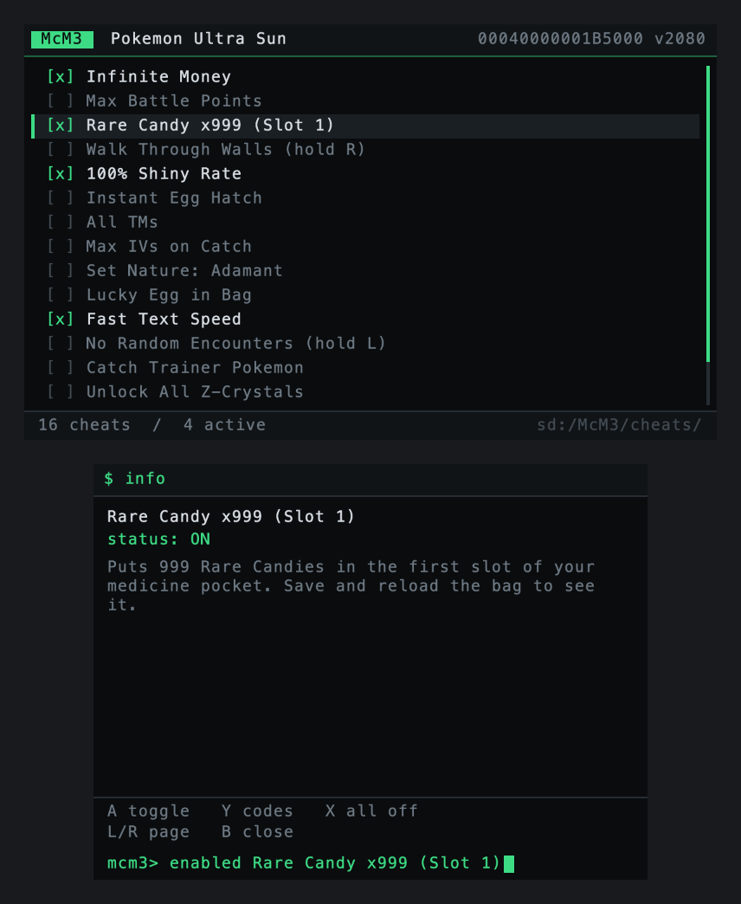
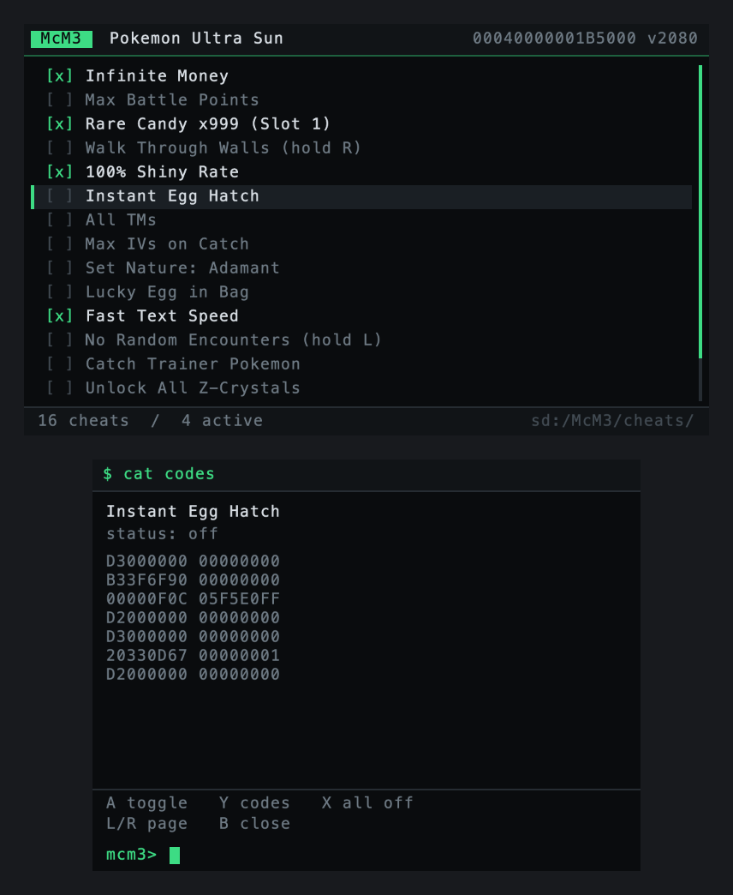

<div align="center">

# McM3

### Meer Cheat Manager 3ds

**A clean, fast, in-game cheat manager for the Nintendo 3DS.**
Open it inside any game, flip cheats on and off, and get back to playing.




</div>

---

## Why McM3?

The cheat menu built into Luma works, but it's bare bones. McM3 gives you a proper cheat manager without leaving your game:

- **Opens on top of any game** with one button combo
- **Both screens used**: cheat list on top, info and codes on the bottom
- **Dark terminal look** that's easy to read, with smooth animations
- **Remembers your cheats** per game, so they're back on next time you play
- **Works with the cheat files you already have** in `sd:/cheats/`
- **Flags broken codes** in red instead of crashing your game

---

## Opening the menu

<div align="center">

### `R` + `Down` + `Select`

</div>

This combo was picked so it **doesn't clash** with other popular homebrew:

| Combo | Used by |
|---|---|
| `L` + `Down` + `Select` | Luma's Rosalina menu |
| `Select` | Standard CTRPF plugin menus |
| `X` + `Y` | NTR |
| `L` + `R` + `Start` + `Select` | Pokemon soft reset |
| **`R` + `Down` + `Select`** | **McM3** |

---

## Controls

| Button | What it does |
|---|---|
| `Up` / `Down` | Move through the list (hold to scroll) |
| `L` / `R` | Jump a page up or down |
| `A` | Turn the selected cheat on or off |
| `Y` | Switch the bottom screen between info and raw codes |
| `X` | Turn every cheat off |
| `B` | Close McM3 and go back to the game |

The game is paused while the menu is open.

---

## Screenshots

<table>
<tr>
<td align="center"><br><sub>Cheat list and info</sub></td>
<td align="center"><br><sub>Raw code view (press Y)</sub></td>
</tr>
<tr>
<td align="center" colspan="2"><br><sub>No cheat file yet? McM3 tells you exactly where to put it</sub></td>
</tr>
</table>

<sub>These are previews rendered from McM3's layout. On a real 3DS the text uses the console's built-in pixel font.</sub>

---

## Installing

**You need:** a 3DS with [Luma3DS](https://github.com/LumaTeam/Luma3DS) custom firmware.

1. Download **`McM3.3gx`** from the [latest release](../../releases).
2. Copy it to your SD card and rename it so it's here:
   ```
   sd:/luma/plugins/default.3gx
   ```
   Using `default.3gx` makes McM3 load in **every game**.
3. On your 3DS, press `L` + `Down` + `Select` to open Rosalina, and turn on **Plugin Loader**.
4. Start any game. After a few seconds you'll see **McM3 ready**.
5. Press `R` + `Down` + `Select`. You're in.

> **Tip:** to use McM3 for only one game, put it at `sd:/luma/plugins/<TitleID>/McM3.3gx` instead.

---

## Adding cheats

McM3 reads standard **Action Replay (Gateway format)** cheat files. It looks in two places, in this order:

| Location | Notes |
|---|---|
| `sd:/McM3/cheats/<TitleID>.txt` | McM3's own folder |
| `sd:/cheats/<TitleID>.txt` | The Luma / Rosalina folder, so files you already have just work |

`<TitleID>` is the game's 16 character ID, for example `00040000001B5000`. McM3 shows the ID in the top right of the menu, so you always know which file to make.

### File format

```ini
[Infinite Money]
{Optional description, shown on the bottom screen}
D3000000 00000000
00000F0C 05F5E0FF
D2000000 00000000

[Another cheat]
XXXXXXXX YYYYYYYY
```

See [`examples/example-cheats.txt`](examples/example-cheats.txt) for a full example.

### Supported code types

| Type | Meaning |
|---|---|
| `0` `1` `2` | 32 / 16 / 8 bit write |
| `3` `4` `5` `6` | 32 bit if (greater, less, equal, not equal) |
| `7` `8` `9` `A` | 16 bit if with mask |
| `B` | Load pointer into offset |
| `C` | Loop |
| `D0` `D1` `D2` | End if, loop end, full terminator |
| `D3` `DC` | Set offset, add to offset |
| `D4` `D5` | Add to data, set data |
| `D6` `D7` `D8` | Write data and move offset |
| `D9` `DA` `DB` | Read into data |
| `DD` | Only run while buttons are held |
| `E` | Patch a block of bytes |

---

## Where McM3 keeps its files

```
sd:/
├── luma/plugins/default.3gx      McM3 itself
└── McM3/
    ├── cheats/<TitleID>.txt      your cheat files
    └── enabled/<TitleID>.txt     which cheats you turned on (made automatically)
```

---

## Roadmap

- [x] In-game overlay with its own hotkey
- [x] Terminal style UI on both screens
- [x] Action Replay engine
- [x] Saves enabled cheats per game
- [ ] Only show codes that match your game's version
- [ ] Download cheats right from the 3DS
- [ ] Community ratings (works / broken) for each code
- [ ] Search and favourites
- [ ] On-device memory search to make your own codes

Have an idea? [Open an issue](../../issues).

---

## Building from source

McM3 is built on [CTRPluginFramework](https://gitlab.com/thepixellizeross/ctrpluginframework) 0.8.0.

```bash
# with devkitARM and libctrpf installed
make
```

Or skip the setup: every push to `main` is built automatically by GitHub Actions using the `pablomk7/libctrpf:0.8.0` Docker image.

---

## Credits

- **[CTRPluginFramework](https://gitlab.com/thepixellizeross/ctrpluginframework)** by Nanquitas, ThePixellizerOSS and PabloMK7
- **[Luma3DS](https://github.com/LumaTeam/Luma3DS)** for the plugin loader and the Action Replay code type reference
- Feature ideas from the folks on r/3dshomebrew

<div align="center">
<br>
<sub>Made by Meer. Not affiliated with Nintendo.</sub>
</div>
