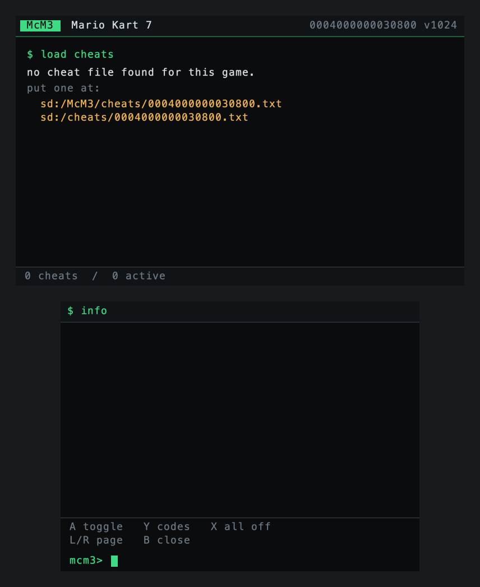
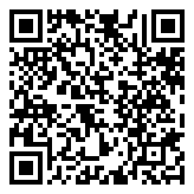

<div align="center">

# McM3

### Meer Cheat Manager 3ds

**A clean, fast, in-game cheat manager for the Nintendo 3DS.**
It detects the game you're playing, ships with cheats for 640+ games, and lets you set exact amounts for things like money and items.


</div>

---

## Why McM3?

- **Detects your game automatically.** Start any game and McM3 tells you what it found and how many cheats are ready.
- **Cheats built in for 644 games.** No downloading cheat files. Pokemon, Smash Bros, Mario Kart 7, Zelda, Fire Emblem, Monster Hunter, Kirby and hundreds more.
- **Pick your own amounts.** Set money, items, Battle Points, Rare Candies and more to the exact number you want.
- **Your own cheats still work** and show up above the built-in ones.
- **Only shows codes for your game version** in Pokemon X/Y, ORAS, Sun/Moon and Ultra Sun/Ultra Moon, so you don't turn on codes made for a different update.
- **Dark terminal look** on both screens, with smooth animations.
- **Remembers your cheats and amounts** per game.
- **Flags broken codes** in red instead of crashing your game.

---

## Opening the menu

<div align="center">

### `R` + `Down` + `Select`

</div>

This combo was picked so it **doesn't clash** with other popular homebrew:

| Combo | Used by |
|---|---|
| `L` + `Down` + `Select` | Luma's Rosalina menu |
| `Select` | Standard CTRPF plugin menus |
| `X` + `Y` | NTR |
| `L` + `R` + `Start` + `Select` | Pokemon soft reset |
| **`R` + `Down` + `Select`** | **McM3** |

---

## Controls

**Cheat list**

| Button | What it does |
|---|---|
| `Up` / `Down` | Move through the list (hold to scroll) |
| `L` / `R` | Jump a page up or down |
| `A` | Turn a cheat on or off. For cheats with an amount, opens the number picker |
| `Y` | Switch the bottom screen between info and raw codes |
| `X` | Turn every cheat off |
| `B` | Close McM3 and go back to the game |

**Number picker** (cheats that show an amount on the right)

| Button | What it does |
|---|---|
| `Up` / `Down` | Change the selected digit |
| `Left` / `Right` | Pick which digit to change |
| `L` / `R` | Jump to the lowest / highest amount |
| `A` | Save the amount and turn the cheat on |
| `X` | Turn the cheat off |
| `B` | Go back without changing anything |

The game is paused while the menu is open.

---

## Built-in cheats

McM3 carries the whole [Sharkive](https://github.com/FlagBrew/Sharkive) database inside the plugin: **644 games and over 11,000 cheats**. When a game starts, McM3 looks up its title ID and loads that game's cheats only.

On top of that, McM3 adds **quick picks**: adjustable versions of popular codes that sit at the top of the list.

| Game | Quick picks |
|---|---|
| Pokemon X | Money, Rare Candies, every pocket's item amounts, Level 100 after battle |
| Pokemon Y | Level 100 after battle |
| Pokemon Omega Ruby / Alpha Sapphire | Money, Rare Candy and level-up items, every pocket's item amounts, Level 100 after battle |
| Pokemon Sun / Moon | Money, Battle Points, all medicine (incl. Rare Candy), all items, all berries, EXP x10 |
| Pokemon Ultra Sun / Ultra Moon | Money, Battle Points, all medicine (incl. Rare Candy), all items, all berries |
| Super Smash Bros. for 3DS (USA) | Gold |

> Pokemon levels can't be set to an exact number with Action Replay codes, because Pokemon data is encrypted in memory. Use the Rare Candy amount or the Level 100 / EXP x10 cheats instead.

**Game not covered?** Some games, like Animal Crossing: New Leaf, aren't in Sharkive. You can still use McM3 with them by adding your own cheat file (see below).

---

## Screenshots

<table>
<tr>
<td align="center"><br><sub>Cheat list and info</sub></td>
<td align="center"><br><sub>Raw code view (press Y)</sub></td>
</tr>
<tr>
<td align="center" colspan="2"><br><sub>No cheats for a game? McM3 tells you exactly where to put yours</sub></td>
</tr>
</table>

<sub>These are previews rendered from McM3's layout. On a real 3DS the text uses the console's built-in pixel font.</sub>

---

## Installing

**You need:** a 3DS with [Luma3DS](https://github.com/LumaTeam/Luma3DS) custom firmware.

1. Download **`McM3.3gx`** from the [latest release](../../releases).
2. Copy it to your SD card and rename it so it's here:
   ```
   sd:/luma/plugins/default.3gx
   ```
   Using `default.3gx` makes McM3 load in **every game**.
3. On your 3DS, press `L` + `Down` + `Select` to open Rosalina, and turn on **Plugin Loader**.
4. Start any game. After a few seconds McM3 shows what it detected, for example **McM3 detected: Pokemon Ultra Sun**.
5. Press `R` + `Down` + `Select`. You're in.

> **Tip:** to use McM3 for only one game, put it at `sd:/luma/plugins/<TitleID>/McM3.3gx` instead.

---

## Updating

McM3 has its own store for **[Universal-Updater](https://github.com/Universal-Team/Universal-Updater)**, so you can install and update it right from your 3DS.

<table>
<tr>
<td></td>
<td>

1. Open **Universal-Updater**.
2. Go to **Settings → Select UniStore → +** and scan this QR code (or enter the URL below).
3. Open the **McM3** store and download **McM3.3gx (all games)**.

When a new version comes out, Universal-Updater shows it as an update. Download it again and you're done.

</td>
</tr>
</table>

```
https://raw.githubusercontent.com/meerok/MeerCheatManager3ds/main/McM3.unistore
```

---

## Adding your own cheats

Your own codes are loaded first and shown above the built-in ones. McM3 looks in two places, in this order:

| Location | Notes |
|---|---|
| `sd:/McM3/cheats/<TitleID>.txt` | McM3's own folder |
| `sd:/cheats/<TitleID>.txt` | The Luma / Rosalina folder, so files you already have just work |

`<TitleID>` is the game's 16 character ID, for example `00040000001B5000`. McM3 shows it in the top right of the menu, so you always know which file to make. If one of your cheats has the same name as a built-in one, yours wins.

### File format

```ini
[Infinite Money]
{Optional description, shown on the bottom screen}
D3000000 00000000
00000F0C 05F5E0FF
D2000000 00000000
```

### Making a cheat adjustable

Add a `$` line to let players pick the amount. Every write of the `match` value is swapped for the chosen number:

```ini
[Money (set amount)]
{Pick any amount from 0 to 9,999,999}
$ 0 9999999 9999999 match=0098967F
08C6A69C 0098967F
```

`$ <min> <max> <default> [match=HEX] [shl=N] [or=HEX] [qty=N at=10|16]`. See [`tools/quickpicks.txt`](tools/quickpicks.txt) for more examples.

### Supported code types

| Type | Meaning |
|---|---|
| `0` `1` `2` | 32 / 16 / 8 bit write |
| `3` `4` `5` `6` | 32 bit if (greater, less, equal, not equal) |
| `7` `8` `9` `A` | 16 bit if with mask |
| `B` | Load pointer into offset |
| `C` | Loop |
| `D0` `D1` `D2` | End if, loop end, full terminator |
| `D3` `DC` | Set offset, add to offset |
| `D4` `D5` | Add to data, set data |
| `D6` `D7` `D8` | Write data and move offset |
| `D9` `DA` `DB` | Read into data |
| `DD` | Only run while buttons are held |
| `E` | Patch a block of bytes |

---

## Where McM3 keeps its files

```
sd:/
├── luma/plugins/default.3gx      McM3 itself (the cheat database is inside)
└── McM3/
    ├── cheats/<TitleID>.txt      your own cheat files (optional)
    └── enabled/<TitleID>.txt     which cheats you turned on and their amounts (made automatically)
```

---

## Roadmap

- [x] In-game overlay with its own hotkey
- [x] Terminal style UI on both screens
- [x] Action Replay engine
- [x] Saves enabled cheats per game
- [x] Detects the running game
- [x] Built-in cheats for 644 games
- [x] Adjustable amounts (money, items and more)
- [x] Only show codes that match your game's version (Pokemon)
- [x] Updates through Universal-Updater
- [ ] Download new cheats right from the 3DS
- [ ] Community ratings (works / broken) for each code
- [ ] Search and favourites
- [ ] On-device memory search to make your own codes

Have an idea? [Open an issue](../../issues).

---

## Building from source

McM3 is built on [CTRPluginFramework](https://gitlab.com/thepixellizeross/ctrpluginframework) 0.8.0.

```bash
# 1. Build the cheat database (needs Python 3)
git clone https://github.com/FlagBrew/Sharkive.git
git clone https://github.com/FlagBrew/Sharkive.wiki.git
python3 tools/build_db.py Sharkive Sharkive.wiki

# 2. Build the plugin (needs devkitARM and libctrpf)
make

# 3. Add the database to the end of the plugin file
python3 tools/pack.py McM3.3gx Data/builtin.bin
```

The database sits at the end of `McM3.3gx`, after the parts Luma loads into memory. McM3 reads only the running game's cheats from the SD card, so the 644-game database doesn't take up any of the game's memory.

Or skip the setup: every push to `main` is built by GitHub Actions. It builds the database from a pinned Sharkive version, compiles the plugin in the `pablomk7/libctrpf:0.8.0` Docker image, then packs the two together.

---

## Credits

- **[Sharkive](https://github.com/FlagBrew/Sharkive)** by FlagBrew and its contributors, for the cheat codes and game names (GPLv3)
- **[CTRPluginFramework](https://gitlab.com/thepixellizeross/ctrpluginframework)** by Nanquitas, ThePixellizerOSS and PabloMK7
- **[Luma3DS](https://github.com/LumaTeam/Luma3DS)** for the plugin loader and the Action Replay code type reference
- Feature ideas from the folks on r/3dshomebrew

## License

McM3 is released under the [GNU General Public License v3.0](LICENSE), the same license as the Sharkive codes it includes.

<div align="center">
<br>
<sub>Made by Meer. Not affiliated with Nintendo.</sub>
</div>
